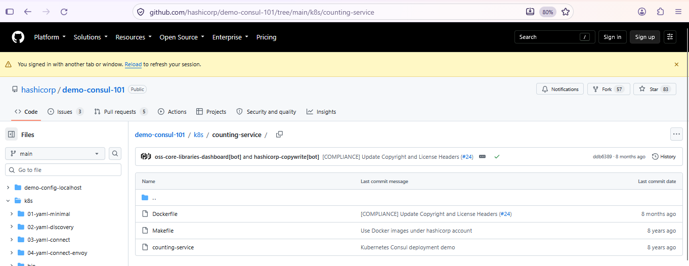
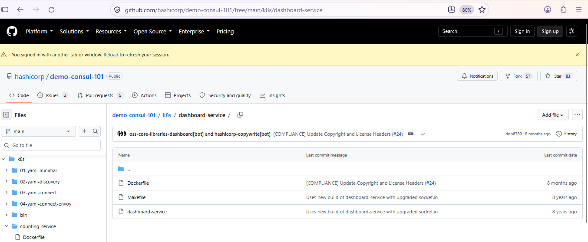
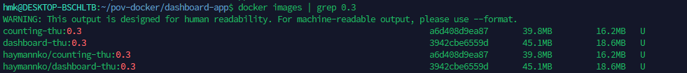
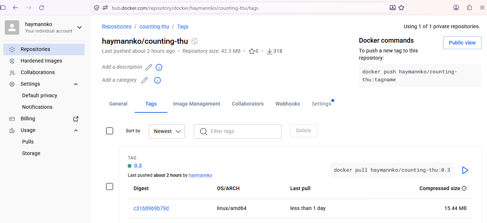
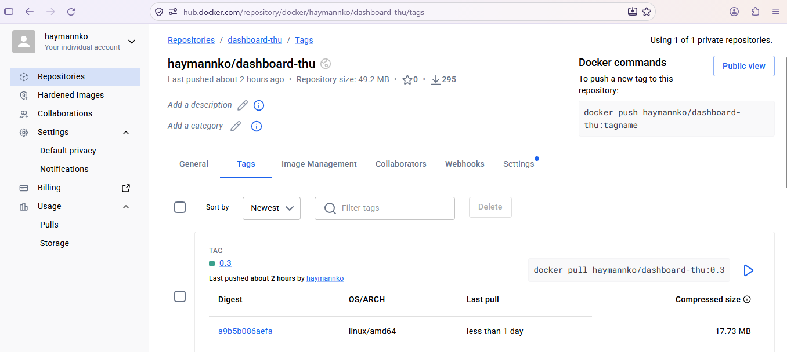
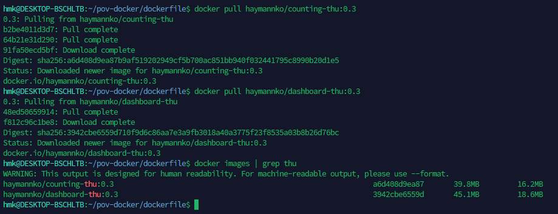
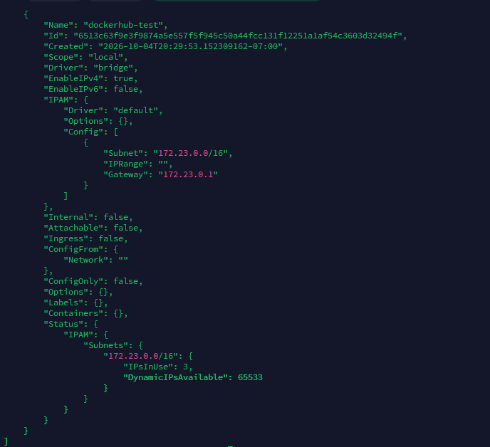
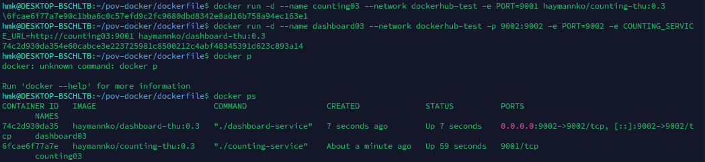
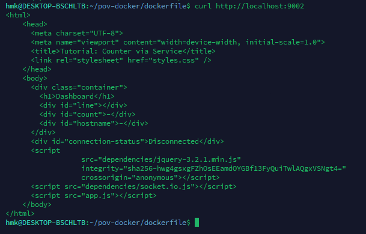
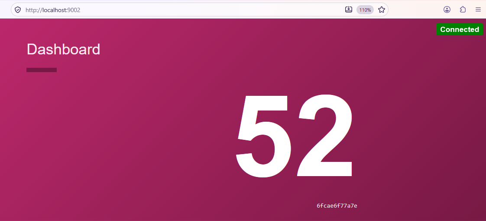

# Dockerfile
## how to build image and push to dockerhub by using Dockerfile
### Create counting-app directory and add these three files 1.Dockerfile to create image, 2.counting-service binary file, 3.Makefile , this is workflow process file then for dashboard-app also like this

## build: ## Build docker imag
### #docker build -t $(IMAGE_NAME):$(VERSION) .
### docker build -t counting-thu:0.3 .
### #docker tag $(IMAGE_NAME):$(VERSION) $(IMAGE_NAME):$(VERSION)
### docker tag counting-thu:0.3 haymannko/counting-thu:0.3
### #docker push $(IMAGE_NAME):$(VERSION)
### docker push haymannko/counting-thu:0.3
### #docker run -it $(IMAGE_NAME):$(VERSION)
### docker run -it haymannko/counting-thu:0.3

### docker images

# Pull counting and dashboard images from dockerhub, run as Continer and test again
### docker pull haymannko/counting-thu:0.3
### docker pull haymannko/dashboard-thu:0.3

### docker network create dockerhub-test
### docker network inspect dockerhub-test

### docker run -d --name counting03 --network dockerhub-test -e PORT=9001 haymannko/counting-thu:0.3

### docker run -d --name dashboard03 --network dockerhub-test -p 9002:9002 -e PORT=9002 -e COUNTING_SERVICE_URL=http://counting03:9001 haymannko/dashboard-thu:0.3

### docker ps

### curl http://localhost:9002

## if error face 
### docker logs dashboard03
### docker logs counting03
### docker inspect counting03 --format '{{json .NetworkSettings.Networks}}'
### docker inspect dashboard03 --format '{{range .Config.Env}}{{println .}}{{end}}'
### docker exec dashboard03 wget -qO- http://counting03:9001
### docker exec counting03 netstat -lntp
### git pull --rebase origin main

